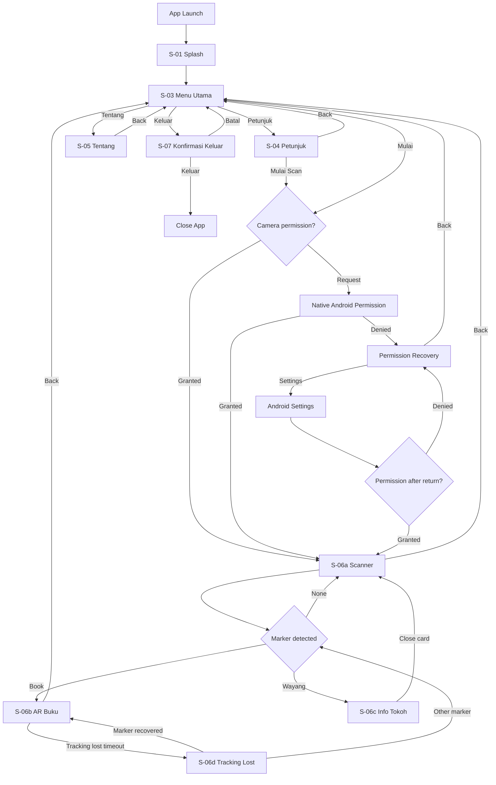
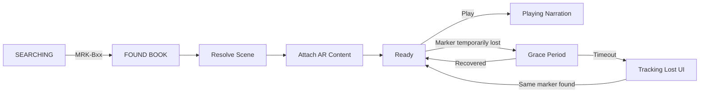
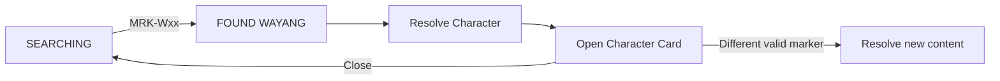
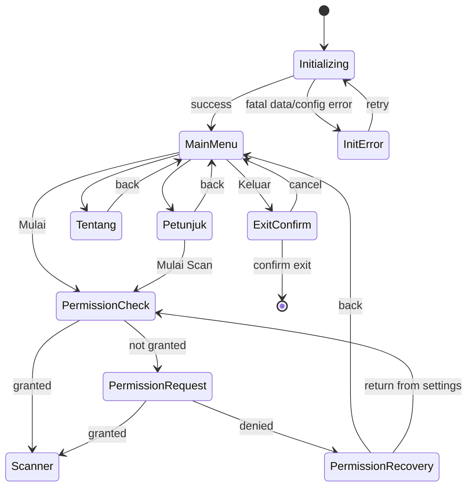
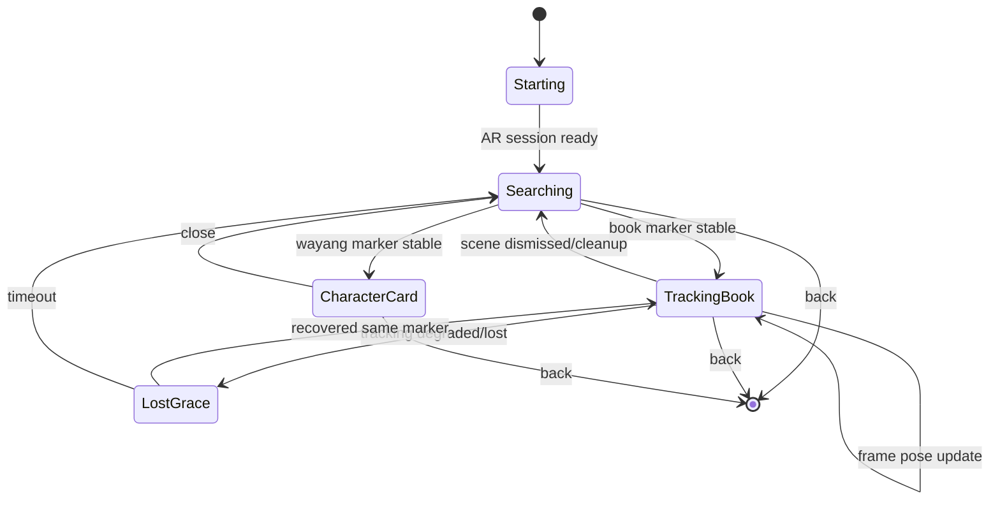
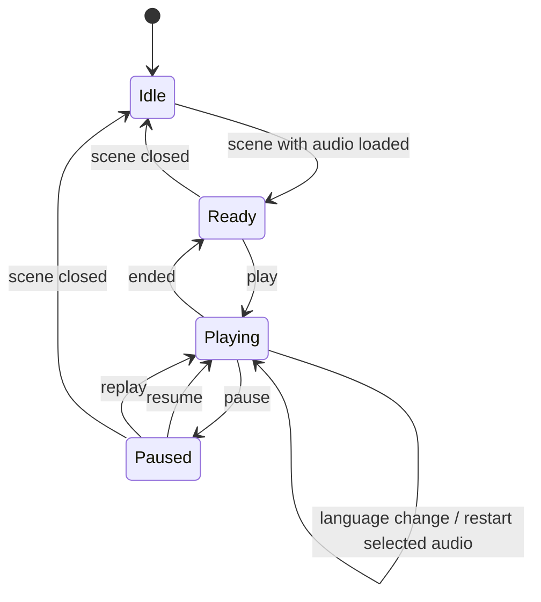

# ASTORYA AI BUILD PACK — ALL IN ONE


---

<!-- SOURCE: README.md -->

# ASTORYA AI BUILD PACK v1.0

Paket ini adalah sumber kebenaran untuk membangun aplikasi Android **ASTORYA**, media edukasi interaktif kisah Ramayana berbasis Augmented Reality (AR) yang terintegrasi dengan buku mewarnai dan wayang fisik.

Tujuan paket ini adalah membuat coding agent dapat melakukan satu *major implementation pass* tanpa mengubah konsep, alur, visual, istilah, atau ruang lingkup ASTORYA secara sepihak.

## Cara menggunakan

1. Letakkan screenshot final di folder `references/` dengan nama yang sudah ditentukan pada `specs/03_UI_UX_SPEC.md`.
2. Letakkan aset final pada folder `assets/` mengikuti `data/asset_manifest.json`.
3. Lengkapi field `TODO_FROM_FINAL_CONTENT` pada `data/scenes.json`, `data/characters.json`, dan `data/markers.json` menggunakan isi buku, proposal, audio, model, dan marker final. Jangan mengarang data yang belum ditetapkan.
4. Berikan seluruh folder ini ke coding agent.
5. Gunakan isi `00_MASTER_BUILD_PROMPT.md` sebagai satu-satunya prompt utama.
6. Coding agent wajib membaca semua file spesifikasi sebelum membuat atau mengubah kode.
7. Hasil dianggap selesai hanya ketika seluruh acceptance test yang relevan lulus dan project dapat dibangun.

## Sumber kebenaran

- **Visual:** screenshot final di `references/` + `03_UI_UX_SPEC.md` + `05_DESIGN_SYSTEM.md`.
- **Perilaku aplikasi:** `02_SRS_ASTORYA.md`, `07_STATE_MACHINE.md`, dan `09_ACCEPTANCE_TESTS.md`.
- **Perilaku AR:** `06_AR_SPEC.md`.
- **Teknologi:** `08_TECH_STACK.md`.
- **File aset:** `data/asset_manifest.json`.
- **Konten cerita/tokoh:** JSON pada folder `data/`.

## Kebijakan anti-halusinasi

Coding agent tidak boleh mengarang:
- adegan cerita yang belum ditulis,
- nama tokoh selain yang sudah ditetapkan,
- isi sumber cerita,
- institusi/pengembang yang belum dikunci,
- audio, model AR, marker, atau asset yang belum tersedia,
- layar atau fitur tambahan.

Jika data wajib belum tersedia, aplikasi harus tetap memiliki struktur kode yang benar dan menandai kebutuhan tersebut secara jelas tanpa mengubah konsep produk.


---

<!-- SOURCE: 00_MASTER_BUILD_PROMPT.md -->

# MASTER BUILD PROMPT — ASTORYA

Build the complete native Android application **ASTORYA** from the files contained in this `ASTORYA_AI_BUILD_PACK_v1.0` folder.

## Non-negotiable instruction

Before writing code, read **every file** under `specs/`, `data/`, and `README.md`. Treat the supplied reference screenshots and production assets as authoritative inputs. Do not redesign, reinterpret, simplify, rename, omit, or add product features unless a specification explicitly requires it.

ASTORYA is an Android portrait educational AR application integrating:
1. a physical 10-page coloring/story book as Augmented Image targets,
2. physical wayang figures as marker targets for character information,
3. local bilingual Indonesian/English narration,
4. child-friendly UI using the ASTORYA golden-cream visual identity.

## Required technology

Use only the technology defined in `specs/08_TECH_STACK.md`.
Do not replace the platform with Flutter, React Native, Unity, a web app, or another framework.
Do not introduce a backend, login system, cloud database, analytics SDK, or online dependency unless explicitly required.

## Build order

Implement in this order:
1. project foundation and design tokens,
2. local data and repositories,
3. navigation and application state,
4. Splash Screen,
5. Main Menu,
6. Petunjuk,
7. Tentang,
8. camera permission handling,
9. AR scanner shell,
10. ARCore Augmented Images database and marker detection,
11. book-marker-to-scene mapping,
12. wayang-marker-to-character mapping,
13. audio ID/EN,
14. tracking lost/recovery,
15. exit confirmation and lifecycle handling,
16. automated tests,
17. build verification.

## Visual source of truth

For visual appearance, use this priority:
1. supplied reference screenshot for that screen,
2. `03_UI_UX_SPEC.md`,
3. `05_DESIGN_SYSTEM.md`,
4. production image assets,
5. PRD narrative.

Do not invent visual components when a supplied production asset already exists.
Do not add bottom navigation, app bar, hamburger menu, floating action button, cards, gradients, shadows, characters, or decorations that are not shown or specified.

The reference Figma frame is **412 × 917 px**, but implementation must use responsive dp/sp layout rather than hardcoded pixel coordinates.

## Behavioral source of truth

For behavior, use this priority:
1. `09_ACCEPTANCE_TESTS.md`,
2. `02_SRS_ASTORYA.md`,
3. `07_STATE_MACHINE.md`,
4. `06_AR_SPEC.md`,
5. `04_USER_FLOW.md`,
6. `01_PRD_ASTORYA.md`.

If two files appear to conflict, apply the higher-priority source for the affected topic and document the conflict in `BUILD_NOTES.md`. Do not silently reinterpret it.

## Data rules

Use only data defined by the JSON files in `data/`.
Do not hardcode story or character content inside UI composables.
Do not fabricate missing story content.
Do not rename marker IDs, scene IDs, or character IDs.

If a JSON record contains `TODO_FROM_FINAL_CONTENT`, preserve the field as unresolved development data and keep the code capable of consuming the final value later.

## AR rules

Implement image recognition according to `06_AR_SPEC.md` using ARCore Augmented Images.
Book markers and wayang markers use the same AR scanner but produce different domain events and UI states.
Only one content experience is considered active at a time.
Do not restart narration on every AR frame update.
Do not create duplicate anchors for the same active marker.
Respect the tracking-loss grace period defined in `data/app_config.json`.

## Permission rules

Do not create a custom camera-permission onboarding screen unless the specification explicitly requires a rationale after denial.
Pressing `Mulai` checks camera permission. If permission is not granted, invoke the native Android permission flow. If denied permanently, show the specified app-level recovery state with `Buka Pengaturan` and `Kembali`.

## Asset rules

Follow `data/asset_manifest.json` exactly.
Asset filenames in the application must use lowercase `snake_case` without spaces, `&`, or other special characters.
If the user's current asset filename differs from the canonical filename, rename/copy it during project preparation and update references consistently.

Never generate a new logo, emblem, character, background, or ornament if the production asset is provided.

## Quality rules

- No placeholder UI may remain in release build when the corresponding production asset is available.
- No TODO may remain in executable behavior that is covered by the supplied data.
- No screen may be unreachable or dead-ended.
- No duplicated audio playback.
- No crash when permission is denied.
- No crash when a marker is absent or lost.
- No network is required for core operation.
- Keep camera processing off the Compose main UI path where appropriate.
- Keep screen state immutable and event-driven.
- Keep business logic outside composables.

## Completion procedure

Before declaring completion:
1. run a clean build,
2. run unit tests,
3. run available instrumentation/UI tests,
4. execute or document each applicable acceptance test,
5. confirm all routes and back behavior,
6. verify camera permission handling,
7. verify AR session lifecycle,
8. verify marker mapping,
9. verify ID/EN audio exclusivity,
10. verify offline operation,
11. create `BUILD_NOTES.md` listing build commands, unresolved content-only TODOs, tested devices/emulators, and any limitation caused by missing physical AR hardware/assets.

The project is not complete merely because it compiles. It is complete only when it satisfies the specifications and acceptance tests.


---

<!-- SOURCE: specs/01_PRD_ASTORYA.md -->

# 01 — Product Requirements Document (PRD) ASTORYA v1.0

## 1. Identitas Produk

**Nama:** ASTORYA  
**Platform:** Android Native  
**Orientasi:** Portrait  
**Reference design frame:** 412 × 917 px  
**Kategori:** Educational AR / Interactive Storytelling  
**Mode utama:** Offline-first  

## 2. Ringkasan

ASTORYA adalah media edukasi interaktif kisah Ramayana berbasis Augmented Reality (AR) yang menghubungkan tiga media: buku mewarnai, wayang fisik, dan aplikasi Android. Buku menyimpan alur cerita serta menjadi image target. Wayang fisik menjadi marker untuk membuka informasi tokoh. Aplikasi menyediakan proses pemindaian, tracking, konten AR, animasi/visual 2.5D, dan narasi Bahasa Indonesia/Inggris.

ASTORYA tidak dimaksudkan menggantikan buku atau wayang, melainkan menambahkan lapisan digital pada media fisik tersebut.

## 3. Problem Statement

Pengalaman belajar cerita tradisional sering bersifat pasif, sedangkan media digital murni dapat mengurangi interaksi pengguna dengan media fisik. ASTORYA menyatukan aktivitas membaca/mewarnai dan interaksi wayang dengan pengalaman digital AR agar pembelajaran lebih aktif, visual, dan menarik.

## 4. Visi

Menyediakan pengalaman belajar kisah Ramayana yang sederhana, ramah anak, visual, interaktif, konsisten secara budaya, dan terintegrasi antara buku, wayang, serta aplikasi Android.

## 5. Tujuan Produk

- Menghubungkan 10 halaman buku dengan konten adegan AR.
- Menghubungkan marker wayang dengan informasi tokoh.
- Menyediakan narasi dalam Bahasa Indonesia dan Bahasa Inggris.
- Membuat jalur menuju pengalaman utama sesingkat mungkin.
- Menjaga konsistensi label, cerita, tokoh, dan visual lintas media.
- Menyediakan status sistem yang mudah dipahami ketika mencari atau kehilangan marker.
- Menjalankan fungsi inti tanpa ketergantungan internet.

## 6. Target Pengguna

### Primer
Anak sekitar usia 8–10 tahun.

Implikasi desain:
- target sentuh utama minimal 56 dp,
- teks sederhana,
- ikon mendampingi informasi penting,
- satu aksi utama per area,
- hindari istilah teknis seperti `tracking`, `anchor`, atau `image target` pada UI pengguna,
- feedback visual segera setelah interaksi.

### Sekunder
Orang tua, guru, pendamping, penguji, dan peneliti.

## 7. Media Sistem

| Kode | Media | Peran |
|---|---|---|
| M-01 | Buku mewarnai 10 halaman | Cerita + image target adegan |
| M-02 | Wayang fisik | Marker informasi tokoh |
| APP | Android | Kamera, deteksi, AR, audio, informasi |

## 8. Scope v1.0

Termasuk:
- Splash Screen,
- Menu Utama,
- Petunjuk,
- Tentang,
- native camera permission,
- AR scanner,
- 10 marker buku,
- marker wayang sesuai aset final,
- konten AR adegan,
- informasi tokoh,
- audio ID/EN,
- tracking lost/recovery,
- konfirmasi keluar,
- penyimpanan pilihan bahasa lokal,
- seluruh konten inti tersedia offline.

## 9. Out of Scope v1.0

Tidak termasuk:
- login/registrasi,
- akun pengguna,
- backend,
- cloud database,
- sinkronisasi antarperangkat,
- leaderboard,
- transaksi,
- media sosial,
- push notification,
- chat,
- dark mode,
- analytics pihak ketiga,
- perekaman atau penyimpanan video kamera.

## 10. Prinsip UX

1. **Menu pusat:** Menu Utama adalah pusat navigasi.
2. **Tidak ada bottom navigation.**
3. **AR full-screen:** kamera mendapat ruang maksimal.
4. **Satu ketukan untuk kembali:** layar non-root memiliki tombol kembali yang jelas.
5. **Label konsisten:** `Mulai`, `Petunjuk`, `Tentang`, `Keluar`, `ID`, `EN`.
6. **Media fisik adalah navigasi:** konten adegan/tokoh muncul melalui marker, bukan melalui daftar konten digital.
7. **Tidak ada jalur buntu.**

## 11. Screen Inventory

| ID | Layar | Tujuan |
|---|---|---|
| S-01 | Splash | Identitas + inisialisasi |
| S-03 | Menu Utama | Pusat navigasi |
| S-04 | Petunjuk | Mengajari penggunaan |
| S-05 | Tentang | Informasi aplikasi, sumber, versi |
| SYS-01 | Android Permission | Izin kamera native |
| S-06a | Scanner — Mencari Marker | Camera feed + guidance |
| S-06b | AR Buku | Adegan AR + narasi |
| S-06c | Info Tokoh Wayang | Kartu informasi tokoh |
| S-06d | Tracking Lost | Recovery guidance |
| S-07 | Konfirmasi Keluar | Mencegah keluar tidak sengaja |

## 12. Success Criteria

MVP dianggap berhasil bila pengguna dapat:
1. membuka aplikasi hingga Menu Utama;
2. membuka Petunjuk dan Tentang;
3. menekan Mulai dan menangani izin kamera;
4. memindai marker buku valid dan mendapatkan adegan sesuai ID;
5. memindai marker wayang valid dan mendapatkan informasi tokoh sesuai ID;
6. mengganti narasi ID/EN tanpa audio tumpang tindih;
7. kehilangan lalu memperoleh kembali tracking tanpa crash;
8. kembali ke Menu Utama;
9. menggunakan fitur inti tanpa koneksi internet.

## 13. Content Model

### Adegan
- `id_adegan`
- `nomor_halaman`
- `judul_adegan`
- `teks_cerita`
- `id_marker`
- `aset_animasi`
- `audio_id`
- `audio_en`

### Tokoh
- `id_tokoh`
- `nama`
- `peran`
- `hubungan`
- `watak`
- `ciri_khas`
- `atribut`
- `id_marker`

### Marker
- `id_marker`
- `jenis`: `BOOK` atau `WAYANG`
- `gambar_referensi`
- `konten_terkait`
- `physical_width_m` bila diketahui

## 14. Risiko Produk Utama

- marker halaman terlalu polos/repetitif dan sulit dideteksi;
- perubahan pewarnaan anak menurunkan kualitas feature matching;
- model/audio terlalu besar sehingga startup lambat;
- UI dekoratif terlalu ramai dan menurunkan keterbacaan;
- narasi berulang ketika tracking berfluktuasi;
- implementasi AR tidak mengikuti lifecycle Activity;
- aset final tidak konsisten dengan nama yang digunakan kode.

Mitigasi teknis dijelaskan pada AR Spec, SRS, dan Acceptance Tests.

## 15. Keputusan yang Belum Boleh Diarang

Nilai berikut hanya boleh diisi dari sumber final pengguna/proposal:
- judul dan isi 10 adegan,
- daftar lengkap wayang/tokoh,
- teks sumber cerita,
- identitas pengembang/institusi final,
- file model/animasi final,
- ukuran fisik marker bila belum diukur.


---

<!-- SOURCE: specs/02_SRS_ASTORYA.md -->

# 02 — Software Requirements Specification (SRS) ASTORYA

## 1. Tujuan

Dokumen ini mendefinisikan requirement perangkat lunak yang dapat diuji. Kata **HARUS** bersifat wajib. Kata **SEBAIKNYA** adalah rekomendasi yang dapat disesuaikan bila ada alasan teknis terdokumentasi.

## 2. Functional Requirements

### A. Startup dan Inisialisasi

- **FR-001** Aplikasi HARUS membuka S-01 Splash saat proses utama dimulai.
- **FR-002** Splash HARUS menampilkan identitas ASTORYA dan indikator pemuatan.
- **FR-003** Splash TIDAK BOLEH memiliki aksi navigasi yang perlu ditekan pengguna.
- **FR-004** Sistem HARUS menginisialisasi repository konten lokal sebelum membuka Menu Utama.
- **FR-005** Sistem HARUS memvalidasi bahwa file konfigurasi utama dapat dibaca.
- **FR-006** Kegagalan membaca data inti HARUS menghasilkan state error yang dapat dipahami, bukan crash mentah.
- **FR-007** Setelah komponen minimum siap, sistem HARUS berpindah otomatis ke S-03 Menu Utama.
- **FR-008** Nilai bahasa terakhir SEBAIKNYA dimuat sebelum scanner pertama dibuka.

### B. Menu Utama

- **FR-010** S-03 HARUS memiliki tepat empat aksi utama: `Mulai`, `Petunjuk`, `Tentang`, `Keluar`.
- **FR-011** Menekan `Mulai` HARUS memulai flow pemeriksaan izin kamera.
- **FR-012** Menekan `Petunjuk` HARUS membuka S-04.
- **FR-013** Menekan `Tentang` HARUS membuka S-05.
- **FR-014** Menekan `Keluar` HARUS membuka S-07, bukan langsung menghentikan aplikasi.
- **FR-015** Menu Utama TIDAK BOLEH menampilkan bottom navigation.
- **FR-016** Menu Utama TIDAK BOLEH menambahkan login, profil, notifikasi, atau menu tambahan.

### C. Petunjuk

- **FR-020** S-04 HARUS menjelaskan urutan penggunaan ASTORYA dengan visual dan teks sederhana.
- **FR-021** Petunjuk utama terdiri dari 3 langkah kanonik: siapkan media, arahkan kamera, nikmati pengalaman AR.
- **FR-022** S-04 HARUS memiliki tombol kembali.
- **FR-023** S-04 HARUS memiliki CTA `Mulai Scan` yang masuk ke flow izin kamera/scanner.
- **FR-024** Informasi ID/EN boleh dijelaskan sebagai hint pendukung, tetapi tidak boleh mengubah tiga langkah utama tanpa revisi desain resmi.

### D. Tentang

- **FR-030** S-05 HARUS menampilkan nama/identitas ASTORYA.
- **FR-031** S-05 HARUS menampilkan deskripsi aplikasi.
- **FR-032** S-05 HARUS menampilkan versi aplikasi.
- **FR-033** S-05 HARUS menampilkan informasi bahasa narasi.
- **FR-034** S-05 HARUS menyediakan tempat untuk sumber cerita tervalidasi.
- **FR-035** S-05 HARUS menyediakan tempat untuk pengembang dan institusi sesuai proposal final.
- **FR-036** Jika konten sumber cerita belum final, release build tidak boleh mengarang sumber.

### E. Permission Kamera

- **FR-040** Sistem HARUS memeriksa permission `CAMERA` sebelum membuka session AR.
- **FR-041** Bila izin belum diberikan, sistem HARUS memanggil dialog permission native Android.
- **FR-042** Bila izin diberikan, sistem HARUS melanjutkan ke scanner tanpa meminta izin ulang pada sesi yang sama.
- **FR-043** Bila izin ditolak tetapi masih dapat diminta ulang, sistem HARUS menyediakan penjelasan singkat dan aksi coba lagi/kembali sesuai kebijakan Android.
- **FR-044** Bila izin ditolak permanen, sistem HARUS menyediakan aksi `Buka Pengaturan` dan `Kembali`.
- **FR-045** Menolak izin TIDAK BOLEH menyebabkan crash.
- **FR-046** Aplikasi TIDAK BOLEH menyimpan foto/video camera feed secara default.

### F. AR Scanner

- **FR-050** Scanner HARUS menggunakan camera feed sebagai latar utama.
- **FR-051** Scanner HARUS menampilkan tombol kembali.
- **FR-052** Scanner HARUS menampilkan kontrol `ID | EN`.
- **FR-053** Kontrol suara HARUS sejajar secara visual dengan kontrol bahasa sesuai desain final.
- **FR-054** Scanner state awal HARUS menampilkan scan frame ornamental.
- **FR-055** Scanner state awal HARUS menampilkan instruksi `Arahkan kamera ke buku atau wayang`.
- **FR-056** Scanner HARUS menampilkan status proses seperti `Sedang mencari marker...` ketika target belum ditemukan.
- **FR-057** Scanner HARUS menggunakan database image target lokal.
- **FR-058** Scanner HARUS menghasilkan event domain berbeda untuk marker buku dan marker wayang.
- **FR-059** Marker tidak dikenal HARUS diabaikan tanpa crash.

### G. Marker Buku dan Adegan AR

- **FR-060** Sistem HARUS mendukung 10 ID marker buku `MRK-B01` sampai `MRK-B10`.
- **FR-061** Setiap marker buku HARUS memetakan tepat satu record ADEGAN.
- **FR-062** Marker `MRK-Bxx` tidak boleh memunculkan adegan dengan ID lain.
- **FR-063** Setelah marker buku valid ditemukan, sistem HARUS membuka state konten AR buku.
- **FR-064** Konten AR HARUS diikat pada pose marker/anchor yang sesuai.
- **FR-065** Sistem HARUS mencegah pembuatan anchor duplikat berulang untuk marker aktif yang sama.
- **FR-066** Scene baru hanya boleh menggantikan scene aktif setelah marker valid yang berbeda benar-benar dikonfirmasi.
- **FR-067** Konten adegan HARUS mengambil model/animasi dan audio dari record data, bukan `if/else` hardcoded tersebar.
- **FR-068** Bila aset scene gagal dimuat, sistem HARUS menampilkan recovery/fallback state tanpa menghentikan camera session secara paksa.

### H. Marker Wayang dan Informasi Tokoh

- **FR-070** Marker wayang HARUS menggunakan ID `MRK-Wxx` yang didefinisikan dalam data final.
- **FR-071** Setiap marker wayang HARUS memetakan tepat satu record TOKOH.
- **FR-072** Setelah marker wayang valid ditemukan, aplikasi HARUS menampilkan kartu informasi tokoh sebagai overlay.
- **FR-073** Kartu HARUS memuat nama tokoh dan field konten yang tersedia: peran, hubungan, watak, ciri khas, atribut.
- **FR-074** Field yang belum tersedia tidak boleh diisi dengan informasi buatan.
- **FR-075** Kartu HARUS dapat ditutup dan mengembalikan pengguna ke scanner.
- **FR-076** Camera feed tetap dapat berjalan di belakang overlay kecuali ada alasan performa yang terdokumentasi.

### I. Bahasa dan Audio

- **FR-080** Bahasa narasi yang didukung HARUS `ID` dan `EN`.
- **FR-081** Default instalasi pertama HARUS `ID`.
- **FR-082** Hanya satu bahasa boleh aktif pada satu waktu.
- **FR-083** Pilihan bahasa terakhir SEBAIKNYA disimpan secara lokal antar sesi.
- **FR-084** Untuk adegan yang memiliki narasi, tombol play HARUS memutar file sesuai bahasa aktif.
- **FR-085** Sistem TIDAK BOLEH memainkan audio ID dan EN secara bersamaan.
- **FR-086** Mengganti bahasa saat audio berjalan HARUS menghentikan audio lama dan memulai audio bahasa baru sesuai keputusan UX final; default spesifikasi: mulai dari awal.
- **FR-087** Tracking update setiap frame TIDAK BOLEH memicu narasi berulang.
- **FR-088** Tombol pause HARUS mempertahankan posisi playback.
- **FR-089** Tombol replay HARUS mengulang narasi dari awal.
- **FR-090** Keluar dari scene HARUS menghentikan audio scene tersebut.

### J. Tracking Lost dan Recovery

- **FR-100** Sistem HARUS membedakan marker aktif, marker hilang sementara, dan scanner tanpa marker.
- **FR-101** Ketika marker aktif tidak lagi full-tracked, sistem HARUS memulai grace period.
- **FR-102** Grace period default adalah nilai `tracking_lost_grace_ms` pada `app_config.json`.
- **FR-103** Bila marker kembali sebelum timeout, state HARUS kembali ke tracking tanpa membuat session/anchor duplikat.
- **FR-104** Bila timeout berakhir, konten AR HARUS disembunyikan/dilepas sesuai renderer policy dan scanner guidance ditampilkan.
- **FR-105** Pesan pengguna HARUS menggunakan bahasa sederhana, misalnya `Marker tidak terlihat`.
- **FR-106** Pemulihan tracking tidak boleh memulai ulang audio secara otomatis bila audio sebelumnya sudah berjalan, kecuali aturan scene final menetapkan lain.

### K. Navigasi dan Lifecycle

- **FR-110** Tombol kembali pada S-04/S-05 HARUS kembali ke S-03.
- **FR-111** Tombol kembali dari scanner HARUS menghentikan resource AR/audio yang tidak lagi diperlukan dan kembali ke Menu Utama.
- **FR-112** Aplikasi HARUS menangani pause/resume Activity tanpa membuat lebih dari satu AR session aktif.
- **FR-113** Setelah kembali dari Android Settings, aplikasi HARUS mengecek ulang permission kamera.
- **FR-114** S-07 HARUS meminta konfirmasi sebelum keluar.
- **FR-115** Aksi batal pada S-07 HARUS kembali ke Menu Utama.

### L. Data Lokal

- **FR-120** Metadata scene, character, marker, dan config HARUS disimpan dalam file lokal terstruktur.
- **FR-121** UI TIDAK BOLEH menjadi sumber data cerita.
- **FR-122** Parsing JSON yang gagal HARUS menghasilkan error terkontrol dan log yang informatif.
- **FR-123** Core feature HARUS dapat berjalan tanpa internet setelah instalasi dan semua aset tersedia.

## 3. Non-Functional Requirements

### Performance
- **NFR-001** UI input harus terasa responsif; operasi berat tidak boleh memblok UI thread.
- **NFR-002** Target rendering pengalaman AR adalah sekitar 30 FPS atau lebih pada perangkat referensi yang kompatibel ARCore.
- **NFR-003** Aset besar sebaiknya dipersiapkan/dimuat secara efisien dan tidak didekode ulang setiap frame.
- **NFR-004** Satu marker aktif tidak boleh menghasilkan anchor/model duplikat per frame.
- **NFR-005** Audio harus mulai tanpa delay yang mengganggu setelah aset lokal siap.

### Reliability
- **NFR-010** Permission denial, missing marker, tracking loss, dan missing optional asset tidak boleh menyebabkan crash.
- **NFR-011** State harus tetap deterministik setelah rotasi dinonaktifkan/portrait locked dan lifecycle pause/resume.
- **NFR-012** Aplikasi tidak boleh memiliki dua instance player aktif untuk narasi scene yang sama.

### Usability
- **NFR-020** Aksi utama minimal 56 dp tinggi.
- **NFR-021** Konten penting tidak bergantung hanya pada warna.
- **NFR-022** Pesan error ditulis dalam bahasa pengguna, bukan stack trace/istilah engine.
- **NFR-023** Tidak ada jalur buntu.

### Privacy & Security
- **NFR-030** Core app tidak membutuhkan akun atau data pribadi.
- **NFR-031** Camera feed tidak disimpan atau diunggah secara default.
- **NFR-032** Core app tidak memerlukan network permission jika benar-benar tidak ada fitur online pada build final.
- **NFR-033** Jangan menambahkan SDK analytics/ads tanpa requirement baru tertulis.

### Maintainability
- **NFR-040** Gunakan single source of truth untuk state layar.
- **NFR-041** Gunakan ViewModel + immutable UI state + event pattern.
- **NFR-042** Pisahkan UI, data, AR, dan audio layer.
- **NFR-043** Marker mapping harus data-driven.
- **NFR-044** Gunakan canonical asset names dari manifest.

### Compatibility
- **NFR-050** Portrait only untuk v1.0.
- **NFR-051** Layout harus responsif dan tidak bergantung pada koordinat pixel 412×917 secara literal.
- **NFR-052** AR hanya dapat dibuka pada perangkat yang memenuhi dukungan ARCore; perangkat tidak kompatibel harus mendapatkan pesan terkontrol.

## 4. External Interface Requirements

### Camera
Input: frame kamera langsung.  
Output: tracking state dan pose marker.

### Local Storage
DataStore untuk preferensi sederhana seperti bahasa terakhir.

### Audio
Local asset URI/file; satu player controller terpusat.

### AR Database
Database image target lokal yang disusun dari marker final.

## 5. Logging

Debug build boleh merekam:
- marker ID ditemukan,
- perubahan tracking state,
- waktu pemuatan asset,
- audio state,
- AR session lifecycle,
- error parsing/config.

Release build tidak boleh membanjiri log dengan frame-by-frame output.


---

<!-- SOURCE: specs/03_UI_UX_SPEC.md -->

# 03 — UI/UX Screen Specification ASTORYA

## 1. Prinsip Umum

- Reference frame Figma: **412 × 917 px**.
- Implementasi: dp/sp responsif, bukan absolute pixels.
- Orientasi: portrait locked.
- Base spacing grid: 4 dp.
- Horizontal content margin utama: 20–24 dp.
- Touch target aksi utama: minimum 56 dp.
- Dekorasi tidak boleh mengurangi keterbacaan atau menutup safe area.
- Gunakan asset ASTORYA final; jangan menggambar ulang logo/karakter bila asset tersedia.

## 2. Visual Language

**Mood:** hangat, edukatif, ramah anak, budaya Jawa/Ramayana, elegan namun tidak formal/kaku.  
**Palette:** cream–gold–brown.  
**Ornament:** kayon/gunungan, awan bergulung, candi berkabut.  
**UI density:** rendah–sedang; pusat layar harus cukup lapang.

## 3. Typography

- UI text: Nunito.
- Heading/display: Baloo 2/Fredoka atau font display yang telah ditetapkan desainer.
- Wordmark ASTORYA: gunakan PNG/SVG asset final, bukan teks yang diketik ulang.
- Body minimum yang disarankan pada frame 412 px: 14–16 sp.
- Tombol: 18–22 sp sesuai hierarchy.
- Heading halaman: 30–40 sp jika tidak menggunakan asset heading.

## 4. S-01 Splash Screen

### Tujuan
Identitas brand + proses inisialisasi.

### Layer canonical
1. `background_splashscreen`
2. dekorasi awan/candi bila background dipisah layer
3. kayon/emblem faint background bila desain final menggunakannya
4. emblem ASTORYA utama
5. wordmark
6. tagline pendek jika ada pada screenshot final
7. Rama & Sinta
8. progress bar
9. status `Menyiapkan pengalaman AR...`
10. `v1.0.0`

### Behavior
- Tidak ada tombol.
- Progress indicator bergerak secara visual.
- Transisi otomatis ke Menu Utama.
- Jangan menambahkan skip.

### Do not
- jangan menambah tombol login/start,
- jangan menambahkan bottom bar,
- jangan mengubah posisi karakter secara bebas jika screenshot final tersedia.

## 5. S-03 Menu Utama

### Hierarchy
1. background menu yang lebih tenang daripada splash,
2. emblem + wordmark ASTORYA di area atas,
3. empat tombol vertikal,
4. landscape/candi dan cloud bank area bawah.

### Tombol
Urutan wajib:
1. Mulai
2. Petunjuk
3. Tentang
4. Keluar

Nominal component guideline:
- width sekitar 240–280 dp pada frame 412 dp,
- height 56–64 dp,
- radius 28–32 dp,
- vertical gap 16–20 dp,
- border dark-gold 1.5–2 dp,
- background cream/gold sesuai screenshot.

### Do not
- Rama/Sinta tidak ditampilkan di menu utama final,
- jangan menambah navigation bar,
- jangan menambah subtitle panjang.

## 6. S-04 Petunjuk

### Title
`Petunjuk`

### Canonical steps
**1. Siapkan buku atau wayang**  
Subtext: `Gunakan halaman buku bergambar atau wayang yang tersedia.`

**2. Arahkan kamera ke marker**  
Subtext: `Pastikan gambar terlihat jelas di dalam bingkai kamera.`

**3. Nikmati pengalaman AR**  
Subtext: `Lihat karakter muncul dan dengarkan narasinya.`

### Layout
- back button kiri atas,
- logo kecil/brand hanya jika ada pada reference final,
- 3 instruction cards stacked,
- setiap card: ilustrasi di kiri, divider halus, text di kanan,
- CTA `Mulai Scan` setelah card terakhir,
- versi boleh di footer jika reference final menampilkannya.

### CTA
`Mulai Scan` harus masuk ke permission/scanner flow, bukan membuat scanner kedua.

## 7. S-05 Tentang

### Title
`Tentang`

### Wajib
- tombol kembali,
- ASTORYA identity,
- deskripsi singkat,
- tujuan edukasi,
- fitur utama,
- versi,
- bahasa,
- pengembang/institusi dari data final,
- sumber cerita tervalidasi.

### Copy yang boleh dipakai
`ASTORYA adalah media edukasi interaktif kisah Ramayana berbasis Augmented Reality.`

`Aplikasi ini membantu anak mengenal cerita, tokoh, dan budaya melalui pengalaman interaktif yang menyenangkan.`

`Fitur utama: pembelajaran interaktif, visual AR, dan narasi bilingual.`

Untuk bagian sumber/pengembang, jangan isi data spekulatif. Ambil dari config/content final.

## 8. SYS-01 Camera Permission

Gunakan dialog native Android. Jangan menggambar dialog permission palsu di dalam Compose.

Rationale internal app bila diperlukan:
**Judul:** `Akses Kamera`  
**Isi:** `ASTORYA membutuhkan akses kamera untuk memindai halaman buku dan wayang serta menampilkan konten Augmented Reality.`

Permanent denial:
**Judul:** `Kamera belum diizinkan`  
**Isi:** `Akses kamera diperlukan untuk menggunakan fitur Augmented Reality ASTORYA.`  
Aksi: `Buka Pengaturan`, `Kembali`.

## 9. S-06a Scanner — Mencari Marker

### Full screen
Camera feed mengisi viewport.

### Top controls
- Back di kiri atas.
- Language `ID | EN` di kanan atas.
- Audio control sejajar dengan language sesuai reference final.

### Scan frame
- 4 L-shaped cream brackets,
- rounded ends,
- golden Javanese curl pada keempat sudut,
- simetris persis,
- bagian sisi tengah terbuka dan memiliki garis pendek tipis,
- pusat transparan.

### Guidance copy
Heading: `Arahkan kamera ke buku atau wayang`  
Subtext: `Pastikan marker terlihat jelas di dalam bingkai.`

Status bottom: `Sedang mencari marker...`

### Visual hierarchy
Camera feed harus tetap terlihat. Overlay tidak boleh terlalu opaque.

## 10. S-06b AR Buku

Ketika marker buku ditemukan:
- scan guidance utama menghilang atau direduksi,
- visual AR tampil anchored pada marker,
- back tetap tersedia,
- ID/EN tetap tersedia,
- audio control tersedia,
- kontrol narasi Play/Pause/Replay dapat tampil dalam panel ringan,
- hindari menutup adegan dengan card besar.

No automatic story list.

## 11. S-06c Info Tokoh Wayang

- Camera feed tetap menjadi konteks.
- Kartu informasi muncul sebagai overlay dari bawah/area aman.
- Card tidak mengisi seluruh layar.
- Nama tokoh menjadi hierarchy utama.
- Field isi disusun ringkas.
- Close button jelas.
- Jika isi panjang, scroll hanya di dalam card.

## 12. S-06d Tracking Lost

Pesan pendek:
`Marker tidak terlihat`
`Arahkan kembali kamera ke buku atau wayang.`

Scan frame kembali aktif.
Jangan menggunakan dialog modal yang menghalangi camera feed sepenuhnya.

## 13. S-07 Konfirmasi Keluar

Modal sederhana dengan visual ASTORYA.

Copy:
`Keluar dari ASTORYA?`
`Apakah kamu ingin menutup aplikasi?`

Aksi:
- `Batal`
- `Keluar`

`Batal` adalah aksi aman/default.

## 14. Responsive Rules

- Gunakan `WindowInsets`/safe area.
- Jangan mengasumsikan punch-hole selalu di tengah.
- Komponen utama menggunakan constraint/Box/Column responsif.
- Background dekoratif boleh crop menggunakan `ContentScale.Crop`.
- Asset logo/character gunakan `ContentScale.Fit`.
- Pada perangkat lebih pendek, card Petunjuk/Tentang boleh scroll vertikal; tombol penting tidak boleh terpotong.

## 15. Visual QA Checklist per Screen

- alignment pusat benar,
- margin kiri/kanan seimbang,
- tidak ada text clipping,
- tombol tidak saling menempel,
- background tidak menurunkan contrast,
- icon style konsisten,
- tidak ada UI Material default yang muncul tanpa styling,
- reference screenshot dibandingkan pada ukuran 412×917 sebelum diterima.


---

<!-- SOURCE: specs/04_USER_FLOW.md -->

# 04 — User Flow ASTORYA

## 1. Primary Flow



## 2. Splash Flow

1. App process mulai.
2. Load config.
3. Load scene/character/marker metadata.
4. Prepare audio controller.
5. Prepare non-camera assets yang diperlukan untuk menu.
6. Bila fatal config error, tampilkan recoverable initialization error.
7. Bila siap, menuju Menu Utama.

AR session tidak harus dibuat saat Splash apabila hal itu memperlambat startup tanpa manfaat. AR session dapat dibuat saat scanner dibuka.

## 3. Scan Flow

1. User menekan `Mulai` atau `Mulai Scan`.
2. Check camera permission.
3. Jika granted → scanner.
4. Jika belum → native permission.
5. Scanner berada dalam `SEARCHING`.
6. Database AR mengenali marker.
7. Mapping marker ke domain content.
8. Book → AR scene.
9. Wayang → character info.
10. Back → cleanup scanner/audio → Menu Utama.

## 4. Book Flow



## 5. Wayang Flow



## 6. Back Navigation Contract

- Petunjuk → Menu Utama.
- Tentang → Menu Utama.
- Scanner/AR → Menu Utama.
- Permission recovery → Menu Utama.
- Character card close → Scanner.
- Exit dialog cancel → Menu Utama.

Tidak ada screen yang menutup aplikasi kecuali aksi konfirmasi `Keluar`.

## 7. Invalid Paths

Aplikasi tidak boleh memiliki:
- Menu Utama → daftar seluruh scene,
- Menu Utama → daftar tokoh,
- direct scene selection,
- login before scanner,
- automatic web page navigation,
- bottom-nav based routing.


---

<!-- SOURCE: specs/05_DESIGN_SYSTEM.md -->

# 05 — Design System ASTORYA

## 1. Design Tokens

```yaml
color:
  cream_primary: "#FDF7EA"
  cream_secondary: "#F0DEB8"
  gold_primary: "#B07F1E"
  gold_dark: "#8A5A12"
  text_primary: "#1B1B1B"
  text_brown: "#6B3B14"
  text_secondary: "#6B5A3E"
  surface_white: "#FFFFFF"
  warning: "#B3261E"
  scanner_cream: "#FFF6E2"
  ornament_gold: "#E0B24F"

spacing_dp:
  xs: 4
  sm: 8
  md: 16
  lg: 24
  xl: 32
  xxl: 40

radius_dp:
  small: 12
  card: 24
  button: 28
  pill: 999

touch_target_dp:
  primary: 56
```

## 2. Typography

### Font family
- UI: Nunito.
- Display: Baloo 2/Fredoka jika sesuai file desain.
- ASTORYA wordmark: image asset.

### Semantic styles
- `DisplayLarge`: halaman seperti Petunjuk/Tentang bila heading berupa text.
- `TitleLarge`: title card.
- `ButtonLarge`: button primer.
- `Body`: instruksi/deskripsi.
- `Caption`: versi/status.

Gunakan `sp` dan scaling Android. Hindari font terlalu tipis.

## 3. Components

### PrimaryButton
Properties:
- label,
- leadingIcon optional,
- enabled,
- loading,
- onClick.

Rules:
- min height 56 dp,
- rounded,
- satu aksi jelas,
- pressed state menurunkan luminance secara halus,
- disabled state tidak hanya dibedakan oleh warna; turunkan opacity dan nonaktifkan input.

### SecondaryButton
Cream surface + dark gold border.

### BackButton
Rounded/square cream control dengan arrow kiri.
Content description wajib.

### LanguageToggle
Pill segmented control `ID | EN`.
Selected segment terlihat jelas.
Hanya dua state.

### AudioControl
Icon control dengan state:
- sound enabled/available,
- playing/paused jika digunakan sebagai transport,
- disabled ketika scene tidak memiliki audio.

### InstructionCard
- cream surface,
- brown/gold border,
- illustration left,
- optional vertical divider,
- title + subtitle right.

### CharacterInfoCard
- cream opaque-enough panel,
- rounded large,
- scroll internal bila perlu,
- close action.

### ScannerFrame
Bukan komponen interaktif. Pointer input harus melewatinya.

### StatusPill
Untuk `Sedang mencari marker...` dan status ringan lain.

### Dialog
Gunakan visual ASTORYA, tetapi tetap mengikuti semantics dialog Android.

## 4. Icon System

Gunakan satu keluarga ikon (Material Symbols Rounded atau aset custom final). Jangan mencampur outline tebal/tipis secara acak.

Custom:
- wayang icon,
- ASTORYA ornamental curls,
- scanner frame.

## 5. Elevation/Shadow

Shadow sangat halus saja. Identitas ASTORYA bukan glossy/3D berat.
- card: low elevation,
- button: low–medium,
- overlay scanner: tidak memakai shadow besar.

## 6. Background Rules

- Splash boleh paling kaya dekorasi.
- Menu lebih lapang.
- Petunjuk/Tentang memiliki centre band yang bersih.
- Scanner tidak memakai background ilustratif; camera feed adalah background.

## 7. Accessibility

- Semua tombol memiliki contentDescription bila label tidak cukup.
- Jangan menggunakan decorative image sebagai semantic node penting.
- Kontras text utama harus jelas di atas cream.
- Minimum touch target 56 dp untuk CTA anak.
- Jangan membuat informasi hanya bergantung pada gold vs brown.

## 8. Animation

Allowed:
- fade/scale ringan antarscreen,
- progress Splash,
- pulse halus scanner status,
- character AR animation dari asset.

Avoid:
- bouncing berlebihan,
- confetti,
- parallax berat,
- animasi yang menggeser tombol saat akan ditekan.


---

<!-- SOURCE: specs/06_AR_SPEC.md -->

# 06 — Augmented Reality Specification ASTORYA

## 1. AR Technology Contract

Gunakan **ARCore Augmented Images** untuk mendeteksi image target 2D. Database target disimpan lokal untuk v1.0. Core AR tidak memerlukan koneksi internet.

## 2. Marker Types

### BOOK
ID: `MRK-B01` s.d. `MRK-B10`.

Fungsi: memicu record ADEGAN.

### WAYANG
ID: `MRK-W01`, `MRK-W02`, dan seterusnya sesuai jumlah wayang final.

Fungsi: memicu record TOKOH.

## 3. Database

- Satu augmented image database aktif cukup untuk marker buku + wayang bila jumlahnya kecil.
- Nama entry database HARUS sama dengan `id_marker` canonical agar mapping deterministik.
- Bila physical width diketahui, simpan dan gunakan untuk meningkatkan konsistensi tracking.
- Jangan menambahkan marker runtime dari network.

## 4. Reference Image Quality

Marker sebaiknya:
- datar,
- memiliki feature visual unik,
- tidak dominan pola repetitif,
- tidak hanya logo/line-art sederhana,
- tidak terkompresi berat,
- memiliki resolusi sumber yang memadai.

Untuk setiap marker final, jalankan quality check dengan tool ARCore yang sesuai dan catat skor. Target pengembangan: score yang kuat/layak sebelum marker disetujui.

### Catatan buku mewarnai
Karena halaman dapat diwarnai anak, database reference harus diuji terhadap:
- halaman sebelum diwarnai,
- pewarnaan ringan,
- pewarnaan padat,
- variasi warna berbeda,
- sebagian tertutup tangan/krayon,
- sudut 0–45 derajat,
- pencahayaan terang/redup wajar.

Jika satu target sangat berubah setelah diwarnai, desain marker perlu mempertahankan feature stabil pada border/ornamen yang tidak diwarnai.

## 5. Initial Detection Guidance

UI meminta pengguna menempatkan marker cukup besar dan jelas di dalam view. Scanner frame adalah panduan komposisi, bukan crop region wajib pada API.

## 6. AR Session Lifecycle

- Create/resume session ketika scanner screen aktif dan permission granted.
- Pause session ketika app/screen pause.
- Release resource ketika keluar scanner bila renderer tidak digunakan lagi.
- Jangan membuat session baru pada setiap recomposition Compose.
- AR session dipelihara oleh lifecycle-aware controller/host view.

## 7. Detection Pipeline

```text
Camera frame
  -> ARCore update
  -> updated AugmentedImage objects
  -> filter valid tracking
  -> get database name/index
  -> map to MarkerRecord
  -> dispatch MarkerDetected(markerId, type)
  -> domain resolver
  -> SceneRecord OR CharacterRecord
  -> UI/renderer state
```

## 8. Tracking Policy

### Fixed vs moving
Buku/wayang dapat digerakkan pengguna. Karena itu, implementation sebaiknya memperhatikan full tracking method untuk pose yang sedang benar-benar terobservasi bila API menyediakan distinction tersebut.

### State
- `SEARCHING`
- `FOUND`
- `TRACKING`
- `LAST_KNOWN/DEGRADED`
- `LOST_GRACE`
- `LOST`

### Grace Period
Default `1500 ms` dari config.

Tujuan:
- mencegah flicker ketika kamera bergerak sesaat,
- menjaga pengalaman audio/visual stabil.

## 9. Active Marker Rule

Hanya satu content experience aktif pada satu waktu.

Jika marker aktif masih tracking dan marker lain terdeteksi:
- jangan langsung mengganti content pada satu frame noise;
- gunakan stabilitas/confirmation singkat bila diperlukan;
- setelah marker baru valid menjadi active marker, cleanup content lama dan load content baru.

## 10. Anchor Rules

- Satu active marker = maksimal satu active content anchor.
- Jangan membuat anchor setiap frame.
- Reuse/update sesuai kemampuan renderer.
- Detach/release anchor ketika content diganti atau scanner ditutup.

## 11. Book AR Rendering

Data dari `scenes.json` menentukan asset.

Preferred asset types:
- GLB/GLTF bila konten merupakan model/2.5D model,
- texture/sprite/billboard bila konten akhir berupa 2D layered animation.

Renderer harus disembunyikan di balik interface sehingga format asset dapat diganti tanpa mengubah navigation/UI.

Contoh interface konseptual:

```kotlin
interface ArContentRenderer {
    fun showScene(scene: Scene, anchorPose: Pose)
    fun updatePose(anchorPose: Pose)
    fun hideScene()
    fun release()
}
```

## 12. Wayang Behavior

Wayang marker memicu UI information card; tidak wajib membuat model 3D baru jika requirement hanya informasi tokoh.

Ketika character card terbuka:
- marker ID tetap diketahui,
- tidak memicu card berulang setiap frame,
- close kembali ke scanner.

## 13. Audio Coupling

AR detection TIDAK boleh langsung memanggil `play()` setiap update.

Flow benar:
1. marker baru menjadi active content,
2. scene state dibuat sekali,
3. audio menunggu user action atau autoplay policy yang secara eksplisit ditetapkan,
4. frame update hanya memperbarui pose/tracking state.

Default aman untuk TA: user menekan Play.

## 14. Failure States

### ARCore unsupported
Tampilkan pesan: perangkat tidak mendukung pengalaman AR ASTORYA.

### Database load error
Return ke menu atau error screen terkontrol; log error.

### Asset scene missing
Tetap jalankan scanner, tampilkan info `Konten belum tersedia` pada debug/development build. Release content harus lengkap sebelum acceptance final.

### Camera interruption
Pause dan resume session sesuai lifecycle.

## 15. Test Matrix Marker

Setiap marker diuji minimal pada:
- 30 cm, 50 cm, 80 cm (sesuaikan ukuran fisik),
- frontal,
- miring ringan,
- portrait/landscape object orientation jika mungkin,
- pencahayaan ruangan terang,
- pencahayaan sedang,
- background meja terang/gelap,
- kamera bergerak perlahan,
- partial occlusion ringan.

Catat detection success dan waktu subjektif/terukur sesuai metodologi TA.


---

<!-- SOURCE: specs/07_STATE_MACHINE.md -->

# 07 — State Machine ASTORYA

## 1. App State



## 2. Scanner State



## 3. Audio State



Rules:
- satu AudioController,
- satu current scene audio,
- `language` adalah state global preference,
- detection frame event tidak mengubah state dari Ready menjadi Playing tanpa explicit playback policy.

## 4. Permission State

States:
- `Unknown`
- `Granted`
- `DeniedCanAskAgain`
- `DeniedPermanently`

UI mapping:
- Granted → scanner,
- CanAskAgain → request/rationale,
- Permanently → `Buka Pengaturan`.

## 5. Language State

```text
ID <-> EN
```

Tidak ada state ketiga. Default ID.

## 6. State Ownership

### AppNavigationState
Navigation controller.

### SettingsState
Language preference.

### ScannerViewModel
- scanner UI state,
- activeMarkerId,
- activeContentType,
- tracking state,
- status message.

### AudioController/ViewModel
- currentAudio,
- position,
- playing,
- language.

### AR Controller
Session + marker tracking + renderer resource; bukan sumber langsung tampilan Compose. Event diteruskan ke ViewModel/domain.

## 7. Idempotency Rules

Event yang sama berulang dari AR frame harus idempotent.

Contoh:
`MarkerTracking(MRK-B01)` 60 kali/detik tidak boleh:
- reload model 60 kali,
- recreate player,
- push screen baru,
- membuat 60 anchors,
- memutar audio ulang.


---

<!-- SOURCE: specs/08_TECH_STACK.md -->

# 08 — Technology Stack ASTORYA

## 1. Platform Decision

**Native Android only.**

Tidak menggunakan Flutter, React Native, Unity sebagai shell aplikasi, WebView app, atau PWA.

## 2. Language

**Kotlin** untuk seluruh application code.

## 3. UI

**Jetpack Compose** + Material primitives yang distyling ulang mengikuti ASTORYA.

Rules:
- jangan membiarkan default Material appearance mengambil alih visual final;
- gunakan composable reusable;
- gunakan unidirectional data flow;
- immutable UI state.

## 4. Architecture

Single-activity application.

Recommended layers:
- `ui`
- `domain`
- `data`
- `ar`
- `audio`

Pattern:
- MVVM,
- ViewModel,
- StateFlow,
- sealed UI events/effects where useful.

Jangan membuat multi-module Gradle untuk v1.0 kecuali ada alasan jelas; satu app module lebih mudah untuk TA dan satu-pass build.

## 5. Navigation

**Navigation Compose**.

Canonical routes:
- `splash`
- `main_menu`
- `petunjuk`
- `tentang`
- `scanner`

Character card dan tracking-lost sebaiknya menjadi state/overlay scanner, bukan route terpisah, kecuali implementasi final membutuhkan route.

## 6. Dependency Injection

**Hilt** untuk repository/controller dependency yang memerlukan lifecycle/scoping.

Jangan menggunakan service locator global tanpa alasan.

## 7. Local Data

- JSON assets untuk scenes/characters/markers/config,
- `kotlinx.serialization` untuk parsing,
- repository read-only untuk content metadata.

## 8. Preferences

**Jetpack DataStore Preferences** untuk:
- bahasa terakhir,
- optional first-run flags bila dibutuhkan kelak.

Tidak perlu Room database untuk v1.0 kecuali requirement berubah.

## 9. Audio

**AndroidX Media3 / ExoPlayer** untuk playback audio lokal.

Satu `NarrationController` mengelola:
- prepare,
- play,
- pause,
- replay,
- stop,
- switch language,
- release.

## 10. Augmented Reality

**Google ARCore SDK — Augmented Images**.

Tujuan:
- deteksi target 2D,
- tracking pose,
- anchor virtual content pada halaman buku.

Database marker dibuat dari gambar target final dan disimpan lokal.

## 11. Renderer

Renderer berada di balik abstraction `ArContentRenderer`.

Preferred production path:
- ARCore untuk tracking,
- Google Filament/glTF path atau renderer Android AR yang kompatibel untuk model GLB/GLTF,
- bila konten final merupakan layered 2D, implementasi boleh memakai textured billboard/plane renderer tanpa mengubah domain contract.

Do not use archived Sceneform APIs as architectural dependency utama.

Jika coding environment menggunakan library helper AR yang aktif dipelihara, library tersebut hanya boleh menjadi implementation detail; public app architecture tetap mengikuti ARCore contract dan tidak mengubah requirement.

## 12. SDK Policy

- `minSdk`: 26 untuk baseline project ini, kecuali pengujian perangkat TA membutuhkan lebih rendah dan seluruh dependency mendukungnya.
- `compileSdk`/`targetSdk`: gunakan stable SDK terbaru yang tersedia pada toolchain ketika project dibuat, lalu pin di Gradle.
- Java/Kotlin toolchain: gunakan versi yang didukung Android Gradle Plugin yang dipilih.

Jangan membuat versi dependency fiktif. Coding agent harus memilih versi stabil yang kompatibel pada waktu build dan menuliskannya di `libs.versions.toml` atau Gradle version catalog.

## 13. Build System

- Gradle Kotlin DSL,
- Version Catalog direkomendasikan,
- build types: `debug`, `release`.

Debug dapat menampilkan log diagnostik marker; release tidak.

## 14. Networking

Tidak ada networking untuk core v1.0.
Jangan menambahkan Retrofit/Ktor/Firebase hanya karena umum digunakan.

## 15. Testing

- JUnit untuk unit tests,
- kotlinx-coroutines-test untuk state/repository bila diperlukan,
- Compose UI testing untuk screen behavior,
- instrumentation/device tests untuk permission/navigation,
- manual/physical AR tests untuk image tracking.

## 16. Coding Rules

- tidak hardcode pixel position,
- tidak hardcode story text ke composable,
- tidak membaca raw JSON berulang kali setiap render,
- tidak membuat AR Session di composable body,
- tidak membuat ExoPlayer baru per recomposition,
- semua resource released mengikuti lifecycle.


---

<!-- SOURCE: specs/09_ACCEPTANCE_TESTS.md -->

# 09 — Acceptance Tests ASTORYA

Status: PASS / FAIL / BLOCKED BY MISSING PHYSICAL ASSET.

## A. Build & Startup

| ID | Given/When | Expected |
|---|---|---|
| AT-001 | Clean project checkout, run build | Build succeeds without source errors |
| AT-002 | App launched | S-01 Splash appears |
| AT-003 | Initialization succeeds | Automatically opens Main Menu |
| AT-004 | Core JSON malformed in debug test | Controlled init error, not raw crash |
| AT-005 | No internet connection | Core startup still succeeds |

## B. Main Menu

| ID | Action | Expected |
|---|---|---|
| AT-010 | Observe menu | Exactly Mulai, Petunjuk, Tentang, Keluar |
| AT-011 | Tap Petunjuk | S-04 opens |
| AT-012 | Tap Tentang | S-05 opens |
| AT-013 | Tap Keluar | Confirmation opens; app not closed yet |
| AT-014 | Compare reference 412×917 | Hierarchy/spacing/visual language matches reference |
| AT-015 | Inspect menu | No Rama/Sinta on final menu unless reference explicitly contains them |

## C. Petunjuk

| ID | Action | Expected |
|---|---|---|
| AT-020 | Open Petunjuk | 3 canonical instruction steps visible |
| AT-021 | Tap Back | Returns Main Menu |
| AT-022 | Tap Mulai Scan | Enters same permission/scanner flow as Mulai |
| AT-023 | Small-height device | Content scrolls if required; CTA remains reachable |

## D. Tentang

| ID | Action | Expected |
|---|---|---|
| AT-030 | Open Tentang | App description/version/language shown |
| AT-031 | Final source data supplied | Source story section shows supplied value exactly |
| AT-032 | Source data absent | App does not fabricate a citation/source |
| AT-033 | Tap Back | Main Menu |

## E. Permission

| ID | Scenario | Expected |
|---|---|---|
| AT-040 | Permission already granted, tap Mulai | Scanner opens without prompt |
| AT-041 | Permission unknown, tap Mulai | Native Android permission request |
| AT-042 | Grant permission | Scanner opens |
| AT-043 | Deny permission | App remains stable and provides recovery/back path |
| AT-044 | Permanent denial | Buka Pengaturan available |
| AT-045 | Grant in Settings, return | Permission rechecked and scanner can open |

## F. Scanner UI

| ID | Scenario | Expected |
|---|---|---|
| AT-050 | Scanner ready | Camera feed visible |
| AT-051 | No marker | Scan frame + guidance + searching status visible |
| AT-052 | Scanner | Back button works |
| AT-053 | Scanner | ID/EN control present |
| AT-054 | Scanner | Sound control aligned with language control per reference |
| AT-055 | Decorative overlay | Does not intercept camera gestures/buttons unexpectedly |

## G. Book Marker Mapping

Repeat AT-060 through AT-063 for B01…B10.

| ID | Scenario | Expected |
|---|---|---|
| AT-060 | MRK-B01 visible | resolves ADG-01 only |
| AT-061 | MRK-B02 visible | resolves ADG-02 only |
| AT-062 | … | one-to-one mapping through B10 |
| AT-063 | Unknown image | no scene, scanner remains stable |
| AT-064 | Same marker tracked across many frames | one active scene/anchor, no duplicate loads |
| AT-065 | Switch to another confirmed book marker | old scene cleaned; new mapped scene shown |

## H. AR Content

| ID | Scenario | Expected |
|---|---|---|
| AT-070 | Book marker active | AR visual anchored/positioned relative to target |
| AT-071 | Move target slowly | virtual content follows supported tracking behavior |
| AT-072 | Exit scanner | renderer resource released/hidden |
| AT-073 | Scene asset missing in debug | controlled diagnostic, no crash |

## I. Tracking Lost

| ID | Scenario | Expected |
|---|---|---|
| AT-080 | Target lost < grace period | no immediate disruptive reset |
| AT-081 | Same target returns within grace | returns to tracking without duplicate anchor |
| AT-082 | Target absent past grace | tracking-lost guidance shown |
| AT-083 | Target returns after timeout | content can be restored normally |
| AT-084 | Rapid tracking fluctuations | narration does not restart per frame |

## J. Wayang

For every final `MRK-Wxx`:

| ID | Scenario | Expected |
|---|---|---|
| AT-090 | Valid wayang marker | correct character card opens |
| AT-091 | Character card | name/available attributes from JSON, no fabricated content |
| AT-092 | Close card | returns scanner |
| AT-093 | Repeated tracking update | one card state, not stacked overlays |

## K. Audio & Language

| ID | Scenario | Expected |
|---|---|---|
| AT-100 | First install | ID selected |
| AT-101 | Select EN | only EN active |
| AT-102 | Play ID narration | correct local ID audio |
| AT-103 | Switch ID→EN while playing | ID stops; EN starts from beginning according to spec |
| AT-104 | Pause | playback position retained |
| AT-105 | Replay | playback starts from zero |
| AT-106 | Close scene | audio stops |
| AT-107 | Relaunch app after EN selected | EN restored if persistence enabled/configured |
| AT-108 | Tracking frame update | audio is not duplicated |

## L. Offline & Privacy

| ID | Scenario | Expected |
|---|---|---|
| AT-110 | Airplane mode | core menu/scanner/local content works |
| AT-111 | Use scanner | no photo/video saved to gallery |
| AT-112 | Inspect app | no login/account requirement |
| AT-113 | Inspect release dependencies | no ad/analytics SDK unless explicitly approved |

## M. Exit & Lifecycle

| ID | Scenario | Expected |
|---|---|---|
| AT-120 | Tap Keluar | confirmation appears |
| AT-121 | Tap Batal | remains in app/Main Menu |
| AT-122 | Confirm Keluar | closes app task according to Android behavior |
| AT-123 | Home/app pause while scanner | AR/audio pause safely |
| AT-124 | Return to app | no duplicate AR session/player |

## N. Visual Regression Checklist

For each reference screenshot:
- screen captured at 412×917 reference viewport,
- background asset is correct,
- logo ratio correct,
- no default Material blue/purple styling,
- button order correct,
- spacing visually equivalent,
- no clipping,
- text copy exact,
- no extra UI.

A coding agent must not mark visual acceptance PASS solely because screen components exist.


---

<!-- SOURCE: specs/10_PROJECT_STRUCTURE.md -->

# 10 — Project Structure & Coding Contract

## 1. Recommended Repository

```text
ASTORYA/
├── app/
│   ├── src/main/java/.../astorya/
│   │   ├── AstoryaApplication.kt
│   │   ├── MainActivity.kt
│   │   ├── navigation/
│   │   ├── ui/
│   │   │   ├── theme/
│   │   │   ├── components/
│   │   │   ├── splash/
│   │   │   ├── menu/
│   │   │   ├── petunjuk/
│   │   │   ├── tentang/
│   │   │   └── scanner/
│   │   ├── domain/
│   │   │   ├── model/
│   │   │   ├── repository/
│   │   │   └── usecase/
│   │   ├── data/
│   │   │   ├── local/
│   │   │   ├── repository/
│   │   │   └── preferences/
│   │   ├── ar/
│   │   │   ├── session/
│   │   │   ├── marker/
│   │   │   ├── renderer/
│   │   │   └── model/
│   │   └── audio/
│   ├── src/main/assets/
│   │   ├── data/
│   │   ├── markers/
│   │   ├── audio/
│   │   └── models/
│   └── src/main/res/
│       ├── drawable/
│       ├── font/
│       └── values/
├── gradle/
├── specs/                  # optional copy of build pack
├── README.md
└── BUILD_NOTES.md
```

## 2. Package Responsibilities

### navigation
Route names dan nav graph saja. Tidak menyimpan business logic.

### ui
Composable, UI state rendering, user events. Tidak membaca JSON langsung.

### domain
Pure models/interfaces/use cases. Tidak bergantung pada Compose.

### data
Parsing file dan preferences.

### ar
ARCore session, image database, marker event, renderer.

### audio
Media3 controller; tidak menaruh audio lifecycle di composable.

## 3. Canonical Models

```kotlin
data class Scene(
    val id: String,
    val pageNumber: Int,
    val title: String?,
    val storyText: String?,
    val markerId: String,
    val animationAsset: String?,
    val audioIdAsset: String?,
    val audioEnAsset: String?
)
```

```kotlin
data class CharacterInfo(
    val id: String,
    val markerId: String,
    val name: String,
    val role: String?,
    val relationship: String?,
    val personality: String?,
    val visualTrait: String?,
    val attribute: String?
)
```

```kotlin
enum class MarkerType { BOOK, WAYANG }
```

## 4. Repository Contracts

```kotlin
interface ContentRepository {
    suspend fun scenes(): List<Scene>
    suspend fun characters(): List<CharacterInfo>
    suspend fun marker(markerId: String): MarkerRecord?
}
```

```kotlin
interface SettingsRepository {
    val language: Flow<AppLanguage>
    suspend fun setLanguage(language: AppLanguage)
}
```

## 5. Scanner Event Contract

```kotlin
sealed interface ArMarkerEvent {
    data class Found(val markerId: String, val type: MarkerType): ArMarkerEvent
    data class Tracking(val markerId: String): ArMarkerEvent
    data class Lost(val markerId: String): ArMarkerEvent
}
```

Frame-level details tidak boleh langsung mendorong navigation.

## 6. ViewModel Rule

ViewModel menerima event, memanggil use case/controller, memperbarui immutable StateFlow.
Composable hanya:
- collect state,
- render,
- emit event.

## 7. Naming

Kotlin:
- class PascalCase,
- functions camelCase.

Assets:
- lowercase snake_case.

Marker IDs/data IDs:
- pertahankan uppercase canonical `MRK-B01`, `ADG-01`, `TKH-01`.

## 8. Asset Location Policy

Visual UI static → `res/drawable` bila sesuai Android resource rules.  
Large/model/audio/marker database → `assets/` sesuai kebutuhan loader.

Jangan menaruh file besar base64 di source code.

## 9. Error Model

Gunakan typed error/domain state. Jangan menyebarkan exception ke UI.

Contoh:
```kotlin
sealed interface ScannerError {
    data object PermissionDenied : ScannerError
    data object ArUnsupported : ScannerError
    data class ContentMissing(val id: String) : ScannerError
    data class Internal(val message: String) : ScannerError
}
```

## 10. Git Hygiene

- `.idea/` local metadata sesuai standard ignore,
- jangan commit signing key,
- jangan commit build output,
- commit marker/art/audio/model assets yang memang dibutuhkan offline jika lisensi dan ukuran memungkinkan.


---

<!-- SOURCE: specs/11_ASSET_GUIDE.md -->

# 11 — Asset Preparation & Naming Guide

## 1. Tujuan

Mencegah coding agent salah memilih asset, menggambar ulang asset yang sudah ada, atau gagal build karena nama file tidak valid.

## 2. Canonical Folder Names

Gunakan:
- `splash_screen`
- `menu_utama`
- `petunjuk_tentang`
- `ar`
- `audio`
- `models`
- `markers`

Jangan gunakan `petunjuk&tentang`.

## 3. Canonical Splash Assets

Berdasarkan aset yang sudah dibuat:
- `asset_rama_sinta.png`
- `awan_depan_atas.png`
- `awan_depan_bawah.png`
- `awan_paling_depan_bawah.png`
- `background_splashscreen.png`
- `candi.png`
- `emblem_astorya.png`
- `wayang.png`
- `wordmark.png`

Jika file lama memakai `asset_rama&sinta.png`, rename menjadi `asset_rama_sinta.png`.

## 4. Raster Export

- PNG dengan alpha untuk emblem, character, cloud, icon, decorative asset.
- Background full-frame boleh PNG/JPG berkualitas tinggi.
- Jangan menyimpan magenta chroma-key pada production asset jika versi alpha sudah tersedia.
- Hapus fringe warna chroma-key sebelum release.

## 5. Reference Frame

Background screen yang sudah final dapat diekspor nominal 412×917 atau resolusi 2x/3x dengan rasio sama. Android implementation tidak boleh menganggap bitmap 412×917 sebagai satu-satunya ukuran device.

## 6. AR Marker Source

Marker source terpisah dari artwork UI.

Simpan:
```text
markers/source/mrk_b01.png
...
markers/source/mrk_b10.png
markers/source/mrk_w01.png
```

Buat augmented-image database dari source final, bukan screenshot UI.

## 7. Audio

```text
audio/adg01_narasi_id.mp3
audio/adg01_narasi_en.mp3
...
```

Naming harus konsisten dengan `scenes.json`.

## 8. Models

```text
models/adg01_scene.glb
...
```

Jika format final berbeda, update manifest + JSON sekali; jangan rename di banyak source file.

## 9. Asset Manifest Rule

Setiap production file harus terdaftar di `data/asset_manifest.json` sebelum digunakan.

Field `status`:
- `available`
- `planned`
- `missing_required`
- `optional`

Coding agent dilarang mengarang file untuk mengganti `missing_required` pada release.


---

<!-- SOURCE: specs/12_CONTENT_RULES.md -->

# 12 — Content & Localization Rules

## 1. Source Content

Cerita Ramayana yang tampil pada buku, narasi, adegan, dan informasi tokoh harus berasal dari sumber yang telah divalidasi dalam proposal/penelitian. Build pack tidak boleh mengarang isi akademik/budaya yang belum disahkan.

## 2. Language

UI utama v1.0 dapat menggunakan Bahasa Indonesia. Kontrol `ID | EN` terutama mengubah narasi/konten bilingual yang disiapkan.

Jika UI bilingual kelak diperlukan, itu merupakan scope baru dan harus memiliki string resource lengkap.

## 3. Copy Canonical

### Menu
- Mulai
- Petunjuk
- Tentang
- Keluar

### Scanner
- Arahkan kamera ke buku atau wayang
- Pastikan marker terlihat jelas di dalam bingkai.
- Sedang mencari marker...
- Marker tidak terlihat
- Arahkan kembali kamera ke buku atau wayang.

### Permission recovery
- Kamera belum diizinkan
- Akses kamera diperlukan untuk menggunakan fitur Augmented Reality ASTORYA.
- Buka Pengaturan
- Kembali

## 4. Version

Display version v1.0.0 untuk mockup/product v1.0, tetapi release code sebaiknya menampilkan `BuildConfig.VERSION_NAME` agar tidak hardcode ganda.

## 5. Missing Content Policy

`TODO_FROM_FINAL_CONTENT` adalah penanda resmi. Coding agent tidak boleh menggantinya dengan fakta buatan.
